# Booking System v3.6

**把每一周，安排清楚。**

Booking System 是在本地浏览器运行的排班与项目管理工作台。围绕人员、项目和交付时间，把排班、预算、实际工时、节点进度与 Task 分工放在一起；FIC 可以独立维护，EIC 可以定期收集多个 FIC 的数据，按来源更新、按人员汇总。

[下载 v3.6](https://github.com/whisper2upp-max/booking-system/releases/tag/v3.6) · [完整使用说明](使用说明_v3.6.md) · [更新日志](更新日志_v3.6.md)

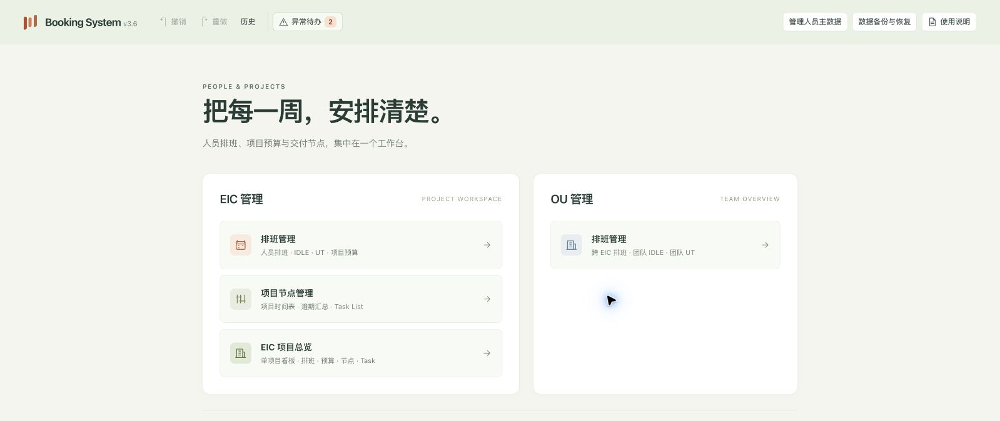

本文截图使用虚构的人员、邮箱、项目和工时。程序安装包不包含这些演示数据，也不包含内部人员名单。

## 功能导航

| 工作内容 | 入口 | 可以做什么 |
| --- | --- | --- |
| 人员资料 | 顶部 → 管理人员主数据 | 下载 Excel 模板、导入替换名单、行内新增和编辑 |
| 排班与负荷 | EIC 管理 → 排班管理 | 导入或手动排班、查看 IDLE 与 UT、调整工时 |
| 项目预算 | 排班管理 → 项目预算 | 比较预算、排班和实际工时，查看超支 |
| 交付进度 | 项目节点管理 | 周视图、日视图、完成状态、进展及注意事项 |
| 项目集中查看 | EIC 项目总览 | 在同一页面查看排班、预算、节点和已保存 Task |
| 任务分配 | 项目节点管理 → 导出 Task List | 生成任务、勾选批量编辑、保存并导出 Excel |
| 数据交换 | 顶部 → 数据备份与恢复 | FIC 提交、EIC 按来源汇总、完整恢复、自动备份 |
| 异常处理 | 顶部 → 异常待办 | 集中处理人员匹配、项目 FIC、超负荷、超支和逾期 |

## 第一次使用

1. 从 [Releases](https://github.com/whisper2upp-max/booking-system/releases) 下载 `booking-system-v3.6.zip`，**完整解压**到固定文件夹。
2. 使用桌面版 Chrome 或 Edge 打开 `app/booking system v3.6.html`。运行依赖随包提供，无需安装开发工具或连接服务器；不要只复制 HTML 文件。
3. 在首次设置窗口选择 **FIC / EIC 维护身份**。FIC 填维护人和所属 EIC，EIC 填自己的姓名；接着选择自动备份文件夹并授权。可以暂时跳过，下次打开会继续未完成的步骤。
4. 点击顶部 **管理人员主数据**，下载模板、填写并导入自己的名单。已有浏览器保存的人员主数据会继续保留。
5. 导入排班或直接手动排班，再维护预算、实际工时、节点和 Task。需要查操作细节时，点击顶部 **使用说明**，按模块浏览或搜索。

**无需先导入排班才能手动排班或维护预算。** 预算项目可以用于手动排班，但仅有预算不会自动创建节点管理中的项目；排班建立项目后，再维护对应项目信息和节点。

## 人员主数据：先建立统一名单

入口：顶部 **管理人员主数据**。下载模板或导出现有名单，在 Excel 中维护后导入；少量修改也可以直接在列表中完成。

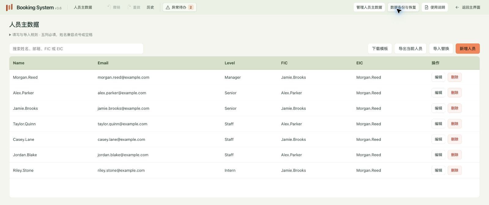

| 必填字段 | 填写要求 |
| --- | --- |
| Name | 英文姓名，支持 `Alex.Parker` 或 `Alex Parker`，保存时统一为点号 |
| Email | 完整邮箱，同一名单中不能重复 |
| Level | 下拉选择 Manager、Senior、Staff、Intern |
| FIC | 英文姓名，点号或空格均可；目前为备用字段，不自动回填项目 FIC |
| EIC | 英文姓名，点号或空格均可 |

点击 **编辑** 后，本行变为输入框，操作按钮变为 **保存 / 取消**；点击 **新增人员**，列表顶部插入一行空白记录。整份导入会先校验和预览，确认后替换名单。

其他上传模块会根据当前主数据匹配姓名，兼容点号、空格及大小写差异；日期支持可识别的日期文本和 Excel 日期数值，明显异常的日期仍需核对。未匹配人员进入 Pending 处理。删除已关联人员不会删除历史工时，其引用会转为独立编号的 Dummy，随后可在异常待办中重新匹配。

## 排班、IDLE 与 UT

入口：**EIC 管理 → 排班管理**。支持公司格式和程序模板导入，也支持直接选择人员、项目、起止周及总工时进行手动排班。

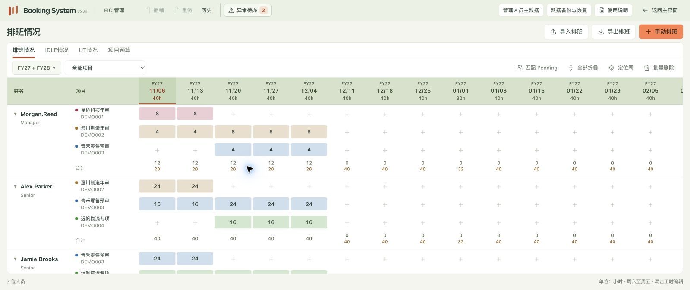

- 按人员展开项目，色块区分项目；同一人员参与多个项目时，工时汇总在该人员下。
- 双击工时格进行编辑，可筛选项目、切换财年、定位周、展开或折叠人员。
- 周按周六至周五计算，表头日期为周五；财年从 7 月至次年 6 月。
- IDLE 展示剩余可用工时，UT 展示排班利用率。可用工时依据程序内置工作日日历计算。

<details>
<summary>查看 IDLE 和 UT 页面</summary>

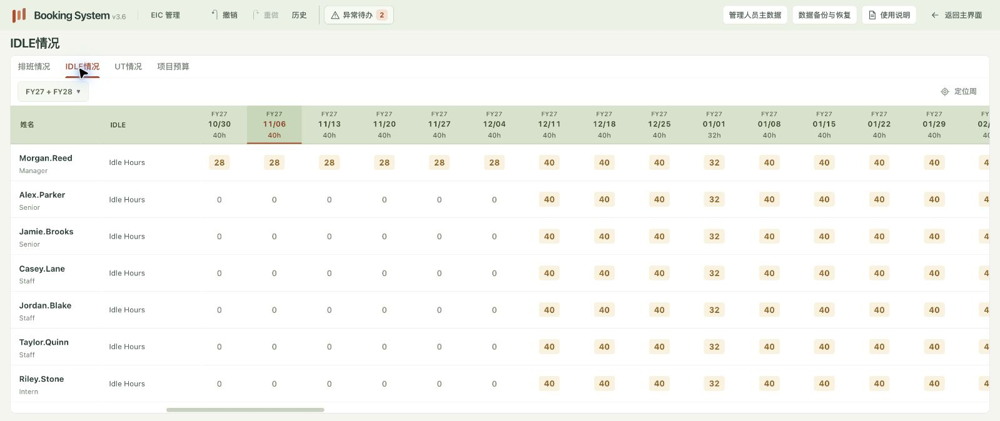

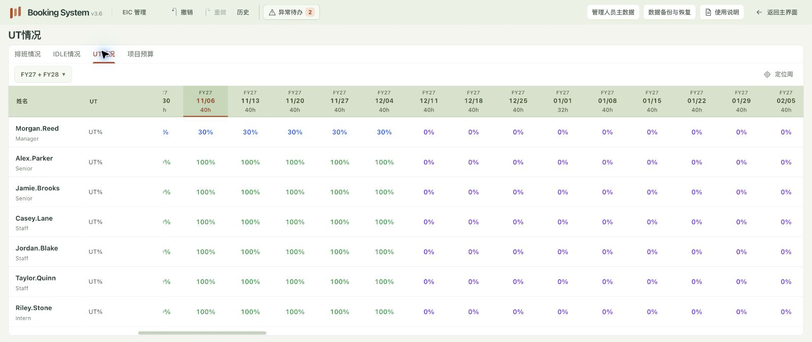

</details>

## 预算与实际工时

入口：**排班管理 → 项目预算**。预算可以先行建立，再逐步安排人员；上传 Timesheet 后，同一项目的预算、排班和实际工时会并排比较。

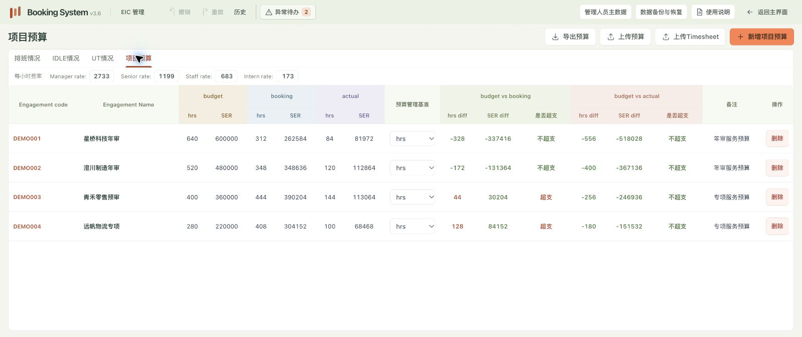

通过 Engagement Code 关联项目，支持工时和 SER 两种管理基准。排班和实际 SER 按人员级别及对应费率计算；页面同时显示差额和超支状态。模板可从相应上传窗口下载。

上传前应核对覆盖范围，尤其是 Timesheet：**上传会整份替换当前实际工时，不会自动保留本次文件之外的项目或月份。** 预算导入则可以选择覆盖已有项目或跳过重复项目。完整边界见 [使用说明中的导入覆盖规则](使用说明_v3.6.md#5-导入覆盖规则与模块导出)。

## 项目节点：从周计划展开到每天

入口：**项目节点管理**。在项目时间表中维护交付日期、项目 FIC、节点完成状态及相关备注。

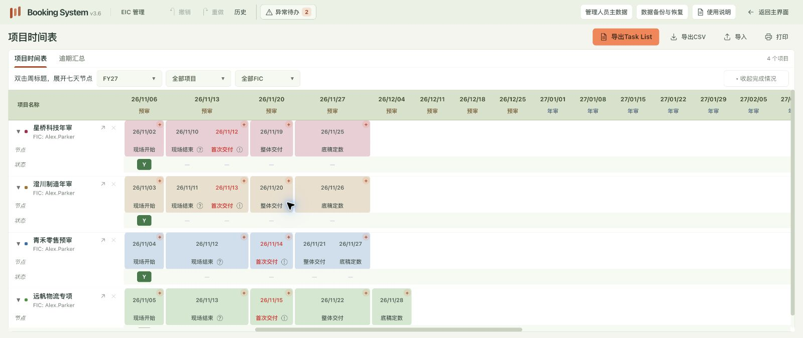

同一周的多个节点按实际日期排列。双击日期编辑节点内容和 **注意事项**；双击节点名称更新完成情况和 **实际进展**。填写注意事项后显示 `!`，填写进展后显示 `?`，悬停图标可查看内容。

双击周标题，表格会展开为该周七天，项目行保持不变；点击 **返回周视图** 回到周计划。

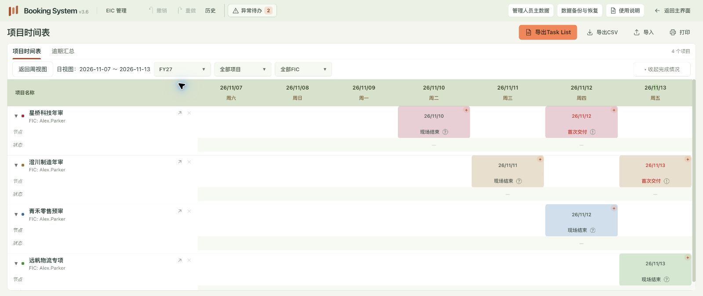

节点管理还支持逾期汇总、导入、CSV 导出和打印。**节点导入是追加，不会按同名日期自动更新原节点**；重复导入前应核对范围。项目信息导入按 Code 匹配，非空值覆盖、空值保留，不能通过空白单元格清空现有字段。

## 项目总览：在一页检查交付与资源

入口：**EIC 项目总览**，或从节点管理进入对应项目。

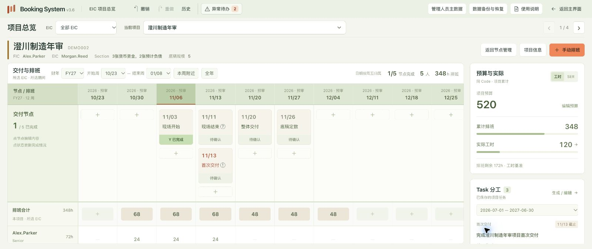

选择 EIC、项目和期间后，可以同时查看交付节点、每周排班、参与人员、预算占用与 Task 分工，并直接维护相应内容。左侧排班和节点受所选期间影响；右侧预算与实际按同一 Code 的项目累计数据统计，核对时要注意两种范围。

## Task List：从交付节点生成分工清单

入口：**项目节点管理 → 导出 Task List**；也可从项目总览进入本项目 Task。

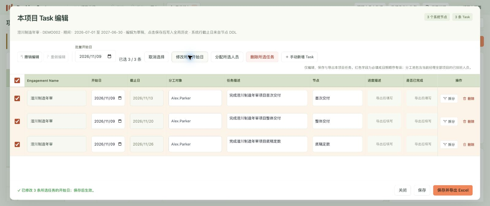

1. 选择日期范围，生成预览。每个交付节点生成一条 Task；现场开始、现场结束和项目组现场仅作为时间标记，不生成任务。
2. 填写开始日，选择一人或多人作为分工对象，核对任务描述；必要时拆分、删除或手动新增任务。
3. 勾选需要处理的行后，可以统一修改开始日、分配人员或删除所选任务，未选行保持不变。
4. 点击 **保存** 或 **保存并导出 Excel**。编辑窗口内的草稿不会自动成为已保存数据。

分工池包含当前经理全部项目的已排班人员。同一项目的系统行截止日来自对应节点；遇到已保存的重叠期间时，程序会询问是否复用，避免误覆盖既有分工。

## FIC 提交与 EIC 汇总

入口：顶部 **数据备份与恢复**。维护身份标识的是数据提交来源，**不按人员主数据中的 FIC 把排班拆组**，因此支持团队之间借用人员。

| 使用者 | 日常操作 | 更新结果 |
| --- | --- | --- |
| FIC | 维护自己的工作台，导出全部数据或提交自动备份 | 文件带 FIC 姓名、固定来源编号和时间 |
| EIC | 使用“导入 FIC 数据”，逐份核对来源和更新预览 | A 文件只更新 A 来源，B、C 来源保留 |
| EIC | 导出全部数据 | 生成 EIC 备份，保留各 FIC 快照及采用规则 |

例如，Alex 给同一人员安排项目一 20 小时，Jamie 安排项目二 20 小时，经理端该人员合计 40 小时。下一周 Alex 提交的同周安排改为 12 小时，汇总变为 32 小时，Jamie 的 20 小时保持不变。

共享人员按主数据邮箱识别；发生人员资料冲突时需确认采用来源。多个 FIC 提供同一项目资料时，经理需选择该项目预算、实际工时、节点和 Task 的统一采用来源；排班仍汇总所有来源，项目总预算不会简单重复累加。

经理收集来源后，业务数据只读；调整应由相应 FIC 修改后重新提交。更换电脑或接续同一 FIC 工作时，应恢复原完整备份以继承来源编号，不要重新创建同名身份。

**接收旧版备份** 用于没有身份标识的旧 JSON：先登记接收来源，再在导入时指定。它不会直接导入业务数据，也不是新增主数据人员。v3.6 文件已带身份，无需登记。

## 数据备份、恢复与升级

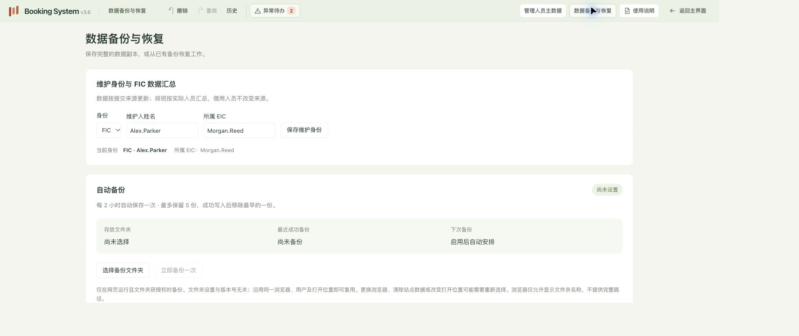

| 功能 | 使用场景 | 范围 |
| --- | --- | --- |
| 导出全部数据 | 留档、迁移、FIC 提交 | 下载当前已保存工作台的 JSON |
| 导入 FIC 数据 | EIC 收集多个团队 | 定向更新一个来源，保留其他来源 |
| 恢复全部数据 | 恢复整份工作台 | 核对后整体覆盖，不做追加合并 |
| 自动备份 | 日常持续保存副本 | 网页运行期间每两小时一次，最多保留五份 |

选择自动备份目录并授权后会立即备份；之后成功写入再清理该配置创建的最早自动备份，手动导出和其他文件不受影响。网页关闭期间不能备份；电脑休眠后恢复运行时补做一次。可以在此页面更改目录、重新授权或立即备份。

完整备份包含人员主数据、EIC 排班、预算、费率、实际工时、项目节点、已保存 Task 和人员匹配关系。**不包含 OU 数据、未保存草稿、页面筛选和过去的操作历史。** EIC 完整备份还保留 FIC 来源快照及采用规则。

身份及备份目录设置不绑定版本号。同一浏览器用户、且新版本可访问原存储时，会沿用已有设置；浏览器可能要求重新授权原目录。更换浏览器、清理站点数据或改变打开位置可能使原存储不可访问，迁移前应导出完整 JSON。

## 数据保存与常见问题

**把程序 ZIP 发给同事，会把我的数据一起带过去吗？**

不会。业务数据保存在当前浏览器中，程序 ZIP 不包含个人工作台。传递人员名单可以使用“导出当前人员”，传递完整工作台使用 JSON 备份。

**误修改后能撤销吗？**

已保存的业务操作可通过顶部撤销、重做或操作历史恢复。Task 草稿另有编辑撤销；进行新的业务修改会清空后续重做记录。历史有保留限制，不能替代文件备份。

**同事打开程序为什么没有人员？**

安装包的人员主数据初始为空，需要导入自己的名单；曾在同一浏览器保存的名单会继续保留。程序不是联网共享数据库，数据不会自动同步到其他电脑。

**姓名或日期格式不同会直接导入失败吗？**

系统会尝试归一化姓名分隔符、识别日期文本及 Excel 日期序号。无法识别的人员、缺失必填项、无效或明显异常的日期仍需处理，上传窗口会列出错误位置和原因。

仓库与 Release 不包含真实人员名单、邮箱映射或业务备份。请勿将填写后的业务 Excel、个人工作台 JSON 或真实业务截图提交到仓库。浏览器本地数据与备份文件均应妥善保管。

## 完整操作说明

程序顶部的 **使用说明** 支持按模块浏览和关键词搜索；[使用说明_v3.6.md](使用说明_v3.6.md) 包含相同的 13 章内容，涵盖 FIC 汇总、数据保存、排班、项目总览、导入覆盖、Pending 匹配、IDLE / UT、预算与实际、OU 汇总、节点、Task、撤销重做及异常待办。

## 开发与构建

`src/workspace.jsx` 和 `src/project-overview.jsx` 为主要界面源码；`app` 包含离线运行文件。修改源码后执行：

```sh
python3 scripts/sync_workspace.py
node scripts/render_guide.cjs
python3 scripts/package_user_release.py
```

构建前会检查内置人员名单必须为空，输出目录为仓库同级的 `使用者分发/v3.6`，压缩包为 `booking-system-v3.6.zip`。

检查：

```sh
node tests/test_workspace_store.cjs
node tests/test_auto_backup.cjs
node tests/test_teams.cjs
node tests/test_teams_ui.cjs
```

浏览器测试需在开发环境提供 Playwright；普通使用者无需安装。测试仅使用虚构人员，不使用真实名单。

## 跨版本设置兼容

维护身份和固定来源编号存于 `booking-workspace-v3` 的 `matches.teamWorkspaceV1`；目录句柄存于 IndexedDB `booking-auto-backup`。这些标识不能拼接版本号，也不能在升级时重置。后续升级必须保留既有字段或执行迁移。

同一浏览器用户和可访问的本地存储中，新版本直接读取既有身份与目录。浏览器若要求目录重新授权，应复用保存的目录句柄；不要求重新输入身份或选择目录。更换浏览器用户、清理站点数据或跨站点则无法直接访问原存储，需要恢复备份或重新授权。

回归检查：`tests/test_upgrade_identity.cjs` 验证更换本地目录及入口文件名后的身份继承；`tests/test_setup_flow_ui.cjs` 验证新版本地址复用目录句柄和完整设置流程。
